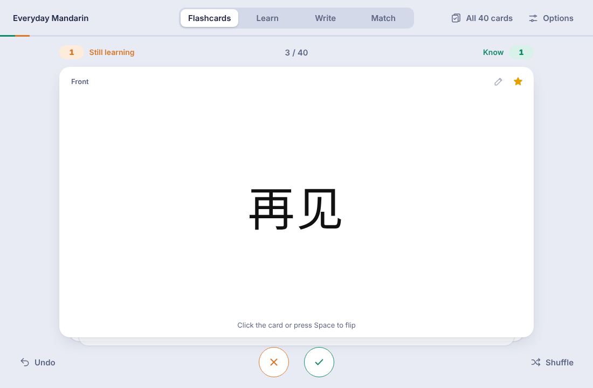
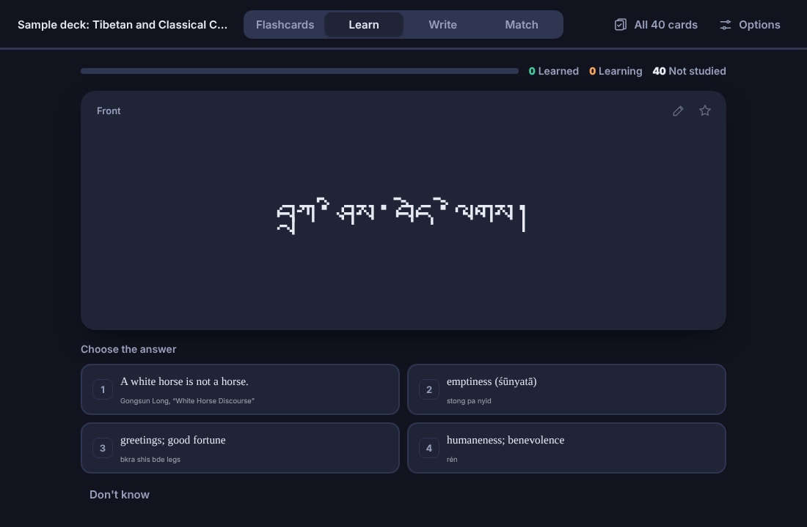
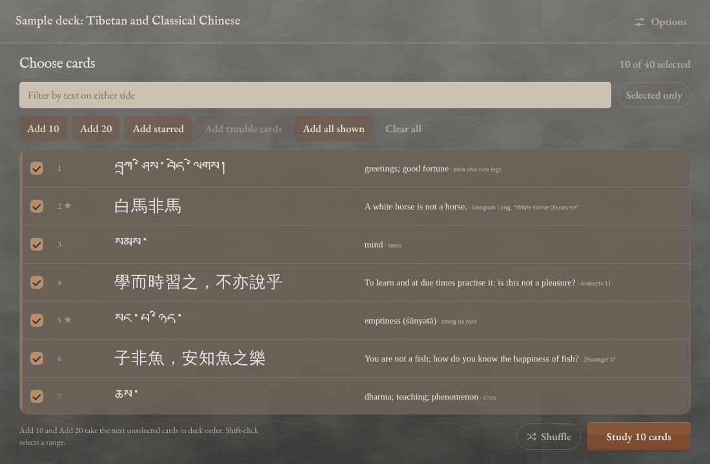
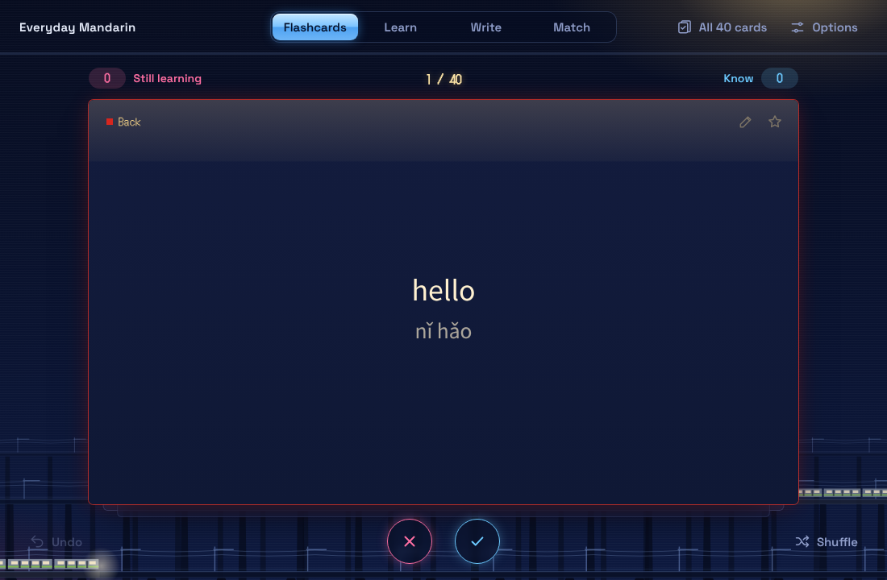
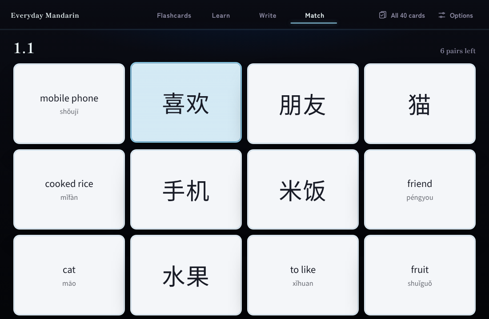

# Flashcard Emulator for Anki

Study any Anki deck the way you would on Quizlet: flip through Flashcards, work through Learn and Write, or race the clock in Match. Choose exactly which cards to study, grow the set as you learn, and pick one of six themes.

Studying here never changes Anki's scheduling. Reviews, due dates and stats stay exactly as they were.



## Modes

- **Flashcards.** Flip with a click, Space, or ↑ / ↓ (the arrow sets which way the card turns). Sort each card into *Know* or *Still learning* with ← / →, or drag it sideways. At the end of a round, review the ones you missed, or add the next 10 cards to the set you're learning.
- **Learn.** Multiple choice first, then typed answers, in small rounds. A card counts as learned after two right answers in a row, and missed cards come back a little later.
- **Write.** Type every answer, then retry the ones you missed.
- **Match.** Pair up terms against the clock (4, 6 or 8 pairs), with a wrong pick adding a one-second penalty. Your best time and recent games are kept per deck.



## Choosing cards

The card picker lets you tick individual cards, filter by text, or use **Add 10**, **Add 20**, **Add starred**, **Add trouble cards** (cards you keep missing) and **Add all shown**. Shift-click selects a range. The selection is remembered per deck.



## Answer checking

Typed answers are forgiving where it makes sense:

- Case, spacing, punctuation, and Tibetan tsheg and shad are ignored.
- Pinyin tone marks or tone numbers are optional, and ü can be typed as `v` or `u:`.
- Traditional and simplified characters count as the same.
- Tibetan can be typed in Wylie.
- Small typos in Latin script are accepted, with the correct spelling shown.
- Any one line of the answer, or one item of a list like "a; b", can count (you can turn this off).

You can always overrule the check with "I was right" or "Count it as wrong".

## Themes

Pick a theme in **Options**, or press **T** to cycle through them.

- **Classic** (the default) and **Classic Dark**
- **Pittsburgh**: cream, soft gold and plum, with the city's bridges along the bottom
- **Tokyo**: night cobalt, dark cards with a shrine-red edge, glossy aqua buttons
- **Edinburgh**: grey stone, limestone cards, oak buttons, old-style type
- **Sapporo**: ink-black and snow, with an optional dark-card mode

Each city theme has an optional background animation, off until you switch it on: falling leaves and river light (Pittsburgh), night trains on elevated tracks (Tokyo), rain in the fog (Edinburgh) and snowfall (Sapporo). The animations stay off when your system asks for reduced motion.





## Other features

- **Text size per side.** Set the front and back text sizes (up to 500%) separately in Options; they're remembered for each deck. This is useful for scripts that render small, like Tibetan.
- **Stars.** Star cards (S), then study only the starred ones.
- **Resume.** If you close the window mid-session, you can pick up where you left off next time.
- **Optional "still learning" tag.** When this is on in Options, notes you miss get a tag (`quizlet::still-learning` by default), and it comes off once you know them. This is the only change the add-on can make to your collection, and Anki's Undo reverses it.
- **Card templates, audio, images, MathJax and template scripts** work as they do in Anki's reviewer. You can also show one chosen field per side instead of the templates.
- **Edit.** Press E to open the current card in Browse. Your edits show up in the study window straight away.

## Install

**From a release:** download the `.ankiaddon` file from the Releases page and open it with Anki (or use *Tools → Add-ons → Install from file…*). Restart Anki.

**From the source:** copy this folder into Anki's add-ons folder (*Tools → Add-ons → View Files*) as `quizlet_emulator`, then restart Anki. Keeping that folder name means updates replace the add-on in place and keep your saved data.

Then open it from **Tools → Flashcard Emulator…**, or from the gear menu next to any deck.

Tested with Anki 26.09.

## Keys

| Key | Action |
| --- | --- |
| Space, click | Flip |
| ↑ / ↓ | Flip upward / downward |
| ← / → | Previous / next, or Still learning / Know when tracking progress |
| S | Star |
| R | Play audio |
| E | Edit in Browse |
| Z | Undo |
| C | Choose cards |
| F, L, W, M | Flashcards, Learn, Write, Match |
| 1–4 | Pick a choice in Learn |
| Enter | Answer, then continue (Learn and Write) |
| O | Options |
| T | Next theme |

## Your data

Stars, card selections, saved sessions, results history, Match times and per-deck text sizes are stored per Anki profile in the add-on's `user_files` folder, which Anki keeps when the add-on is updated. Settings are in the add-on's config (*Tools → Add-ons → Config*); `config.md` describes each one.

## Building the .ankiaddon

```
python3 build_ankiaddon.py
```

This writes `flashcard_emulator.ankiaddon` next to the script, leaving out the README, screenshots, your `user_files` data and other files Anki doesn't need.

## Credits

The theme fonts are under the SIL Open Font License, and the traditional/simplified Chinese table comes from hanziconv by Bernard Yue (Apache License 2.0). See `CREDITS.txt` and the `licenses` folders.
